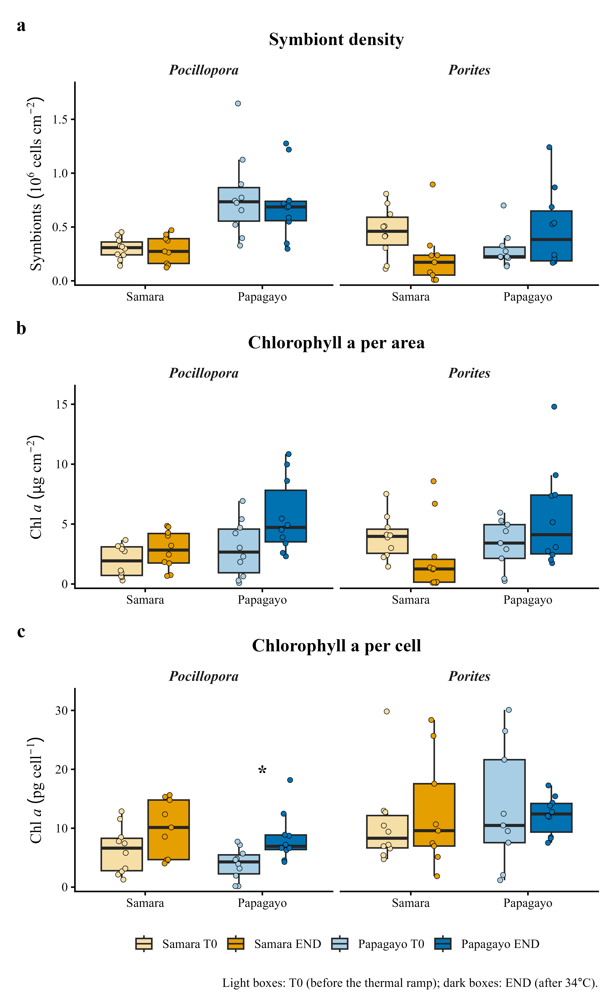
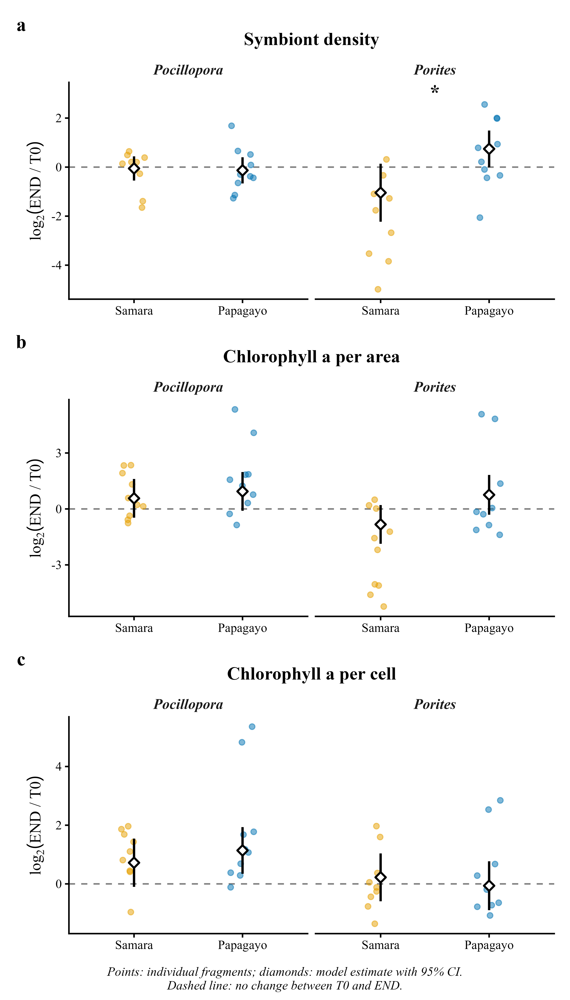

# Lab Notebook — CIMAR Coral Physiology, Costa Rica 2026

**Project:** PhD Chapter 2 — Thermal performance of *Pocillopora* sp. and *Porites* sp. from upwelling vs. non-upwelling reefs
**Researcher:** Dar Golomb (University of Haifa; supervisor Prof. Tali Mass)
**Field station:** CIMAR, Costa Rica
**Repository:** `Costa-Rica-TPC` (physiology part)  
**Notebook started:** 20 Oct 2026 (entries for Feb 2026 reconstructed from field files, lab sheets and the lab protocol)

> Convention: each entry has **Aim → What was done → Observations / decisions → Files**. Dates are YYYY-MM-DD. Items not yet confirmed are marked **[TO CONFIRM]**.

---

## Contents

1. [Background and hypothesis](#background-and-hypothesis)
2. [2026-02-11 — Field collection, Sámara](#2026-02-11--field-collection-sámara)
3. [2026-02-15 — Field collection, Papagayo](#2026-02-15--field-collection-papagayo)
4. [Feb 2026 — Acclimation and acute thermal ramp](#feb-2026--acclimation-and-acute-thermal-ramp)
5. [Feb 2026 — Tissue processing (physiology)](#feb-2026--tissue-processing-physiology)
6. [2026-10-19 — Data cleaning and QC](#2026-10-19--data-cleaning-and-qc)
7. [2026-10-19 — Choosing the statistical model](#2026-10-19--choosing-the-statistical-model)
8. [2026-10-19 — Final analysis, diagnostics and figures](#2026-10-19--final-analysis-diagnostics-and-figures)
9. [2026-10-19 — Results](#2026-10-19--results)
10. [2026-10-20 — Repository set-up](#2026-10-20--repository-set-up)
11. [Open issues and next steps](#open-issues-and-next-steps)

---

## Background and hypothesis

- **Ch. 1** (preprint 2026, DOI 10.20944/preprints202605.1556.v1) showed that seasonal upwelling shapes reef community structure and photophysiology on the Pacific coast of Costa Rica.
- **Ch. 2 (this experiment):** thermal performance curves (TPC) and physiology of *Pocillopora* sp. and *Porites* sp. from both sites.
- **Hypothesis (climate variability hypothesis):** corals from the upwelling site (Papagayo), which experience larger temperature fluctuations, have broader thermal windows, a higher T_opt and greater resistance to photosynthetic collapse than corals from the thermally stable site (Sámara).
- **Physiology question addressed here:** does the acute ramp change symbiont density and chlorophyll *a* (T0 → END), and does that change differ between sites?

| Site | Coordinates | Regime |
|---|---|---|
| Papagayo (Playa del Coco) | 10°33′N, 85°42′W | Seasonal upwelling (Dec–Apr), cooler, lower pH |
| Sámara | 10°00′N, 85°52′W | Sheltered, non-upwelling, warmer, stable |

---

## 2026-02-11 — Field collection, Sámara

**Aim:** collect fragments of *Pocillopora* and *Porites* from the non-upwelling site.

**Done:**
- 10 fragments per species from separate colonies (≥ 5 m apart), ~4 m depth.
- YSI profile at collection.

**Observations:** 26.1–26.6 °C, pH 8.29, salinity 33.2 PSU.

**Files:** `Data/Physiology/Env_Data/260211-*.csv`

---

## 2026-02-15 — Field collection, Papagayo

**Aim:** collect the same species from the upwelling site.

**Done:** as at Sámara — 10 fragments per species, separate colonies ≥ 5 m apart, ~4 m depth; YSI profile.

**Observations:** 25.5–25.6 °C, pH 8.18, salinity 33.5 PSU (cooler and lower pH than Sámara, consistent with upwelling influence).

**Files:** `Data/Physiology/Env_Data/260215-*.csv`

---

## Feb 2026 — Acclimation and acute thermal ramp

**Aim:** expose all fragments to an acute ascending temperature ramp and measure performance at each step.

**Done:**
- 18 h acclimation in a tank at the ramp start temperature (Papagayo 22 °C, Sámara 24 °C).
- 5 fragments per day over 2 consecutive days per site. Exact run dates **[TO CONFIRM]**.
- Ramp on the **same fragments**, ~45 min per step:
  - Papagayo: 22, 24, 25\*, 26, 28, 30, 32, 34 °C (~6 h)
  - Sámara: 24, 26, 28, 30, 32, 34 °C (~4.5 h)
  - \*On Papagayo day 2 the second step reached 25 °C instead of 24 °C.
- At each step: light incubation (~15 min) → dark incubation (~15 min) → FIRe fluorometry. Light 173–210 µmol photons m⁻² s⁻¹.
- **Physiology sampling:** T0 = before the ramp; END = after the 34 °C step. T0 and END come from the **same fragment** (repeated measures); END is only hours after T0.

**Note:** colony numbers in the Methods appendix (P–I curves) refer to separate fragments and are not used for the physiology data.

---

## Feb 2026 — Tissue processing (physiology)

Follows `Data/Physiology/Protocol/Protocol for coral physiology.docx` (the lab protocol, not Methods v4).

**Tissue removal and fractions**
1. Airbrush tissue with 4 mL filtered seawater (FSW)/PBS.
2. Split homogenate into two 2 mL tubes (one is a duplicate).
3. Centrifuge; supernatant = host fraction for protein; pellet = algae.

**Surface area (aluminium foil):** SA (cm²) = (foil mass mg + 0.0901) / 0.0455

**Endosymbiont density**
- Pellet resuspended in 1 mL FSW; 10 µL on a hemocytometer, 5 fields counted (Fiji), 0.0001 mL per field.
- Cells mL⁻¹ = mean count / 0.0001
- **Cells cm⁻² = Cells mL⁻¹ × 1 mL × 2 / SA** (×2 because the homogenate was split into two halves)

**Chlorophyll *a*** (Ritchie 2008; blank = 95 % acetone)
- 1 mL resuspension → 2 × 500 µL, each + 4 mL 95 % acetone (duplicates).
- Chl *a* (µg mL⁻¹) = −0.3319·A630 − 1.7485·A647 + 11.9442·A664 − 1.4306·A691
- **Chl *a* (µg cm⁻²) = µg mL⁻¹ × 4.5 mL × 2 (0.5 → 1 mL) × 2 (two halves) / SA**
- **Chl *a* (pg cell⁻¹) = Chl *a* µg cm⁻² / cells cm⁻² × 10⁶**

**Protein** — Bradford assay on the supernatant. Volumes differ between protocol (80 µL + 3 mL) and lab sheet (10 µL + 300 µL) **[TO CONFIRM]**. Not yet analysed (see Open issues).

**Files:** `Data/Physiology/Raw/Physiology_CIMAR_2026.xlsx`, `Data/Physiology/Raw/Protein quantititation of Papagayo Samara samples Feb 2026.xlsx`

---

## 2026-10-19 — Data cleaning and QC

**Aim:** build a single, analysis-ready file from the raw lab sheets.

**Done:**
- Created `Data/Physiology/Physiology_CIMAR_clean.xlsx` with sheets `Endosym`, `Chl` and `README` (formulas and flags documented in the file).
- Standardised IDs: `SAM/PAP_POC/POR_##` (Sámara POC 01–10, POR 11–20; Papagayo POC 21–30, POR 31–40), with `Timepoint` = T0/END and lab `Tube` number.
- Recalculated cells cm⁻² and Chl *a* from raw counts and absorbances with the formulas above.
- Added a chlorophyll QC flag:

| Flag | Rule | n tubes |
|---|---|---|
| `TURBID` | A664 < A630 or A691 | 11 |
| `REP_DIFF` | duplicate A664 differ > 50 % | 10 |
| `LOW_ABS` | A664 < 0.01 | 5 |
| `NEG` | negative Chl *a* → set to NA | 1 |

**Observations:**
- **Missing symbiont counts (2):** SAM_POC_10 END and SAM_POR_11 END — pellet scarce and lost during centrifugation/washing; not counted.
- **Negative chlorophyll (1):** PAP_POR_31 T0 (tube 139) → NA.
- **Turbidity pattern:** 10 of the 11 `TURBID` tubes are Papagayo T0. Flagged tubes are **kept** in the main analysis; the script can exclude them (`EXCLUDE_CHL_QC <- c("TURBID")`) as a sensitivity check.
- Final N: symbiont density 78, Chl *a* area 79, Chl *a* cell 77 observations from 40 fragments.

**Files:** `Data/Physiology/Physiology_CIMAR_clean.xlsx`

---

## 2026-10-19 — Choosing the statistical model

**Aim:** a test that respects the paired design and the distribution of the data, robust enough for examiners.

The earlier analysis was a Python notebook (`Scripts/Physiology/Archive/Spat_Physiology.ipynb`); it was converted to R and the approach was revised step by step.

| # | Approach | Outcome | Reason |
|---|---|---|---|
| 1 | Unpaired t-test / Wilcoxon per group | **Rejected** | Ignores that T0 and END are from the same fragment; many separate tests, no interaction test |
| 2 | LMM on log10 data, `(1 | Fragment)` | **Rejected** | Residuals non-normal and heteroscedastic |
| 3 | **GLMM, Gamma (log link), `(1 | Fragment)`** | **Selected** | Response is strictly positive, right-skewed, variance rises with the mean; log link gives effects as ratios (END/T0) |

**Final model** (one per response):

```r
glmmTMB(Value ~ Timepoint * Site * Species + (1 | Fragment_ID),
        family = Gamma(link = "log"),
        dispformula = ~ Site * Species)   # only if LRT p < 0.05
```

**Decisions:**
- **Heteroscedasticity:** compare constant dispersion vs. dispersion ~ Site × Species by likelihood-ratio test; keep the more complex one only if p < 0.05.
- **Fixed effects:** Type III Wald χ² with sum-to-zero contrasts (needed for meaningful main effects in the presence of interactions).
- **Planned contrasts (emmeans, response scale):**
  1. END vs. T0 within each Site × Species → ratio END/T0.
  2. Does the response differ between sites? → interaction contrast (END/T0 Papagayo) / (END/T0 Sámara), per species.
  - Benjamini–Hochberg correction within each response.
- **Validation:** DHARMa simulated residuals (1000 simulations, `set.seed(2026)`).

---

## 2026-10-19 — Final analysis, diagnostics and figures

**Done:** ran `Scripts/Physiology/CIMAR_Physiology.R` (R 4.6.1, Windows 11; package versions in `Output/Physiology/sessionInfo.txt`).

**Dispersion model selection**

| Response | LRT p | Dispersion used |
|---|---|---|
| Symbiont density | 0.0002 | ~ Site × Species |
| Chl *a* per area | 0.24 | constant |
| Chl *a* per cell | 0.38 | constant |

**DHARMa diagnostics** — all models converged and passed every check:

| Response | N | KS uniformity p | Dispersion p | Outlier p | Homogeneity p |
|---|---|---|---|---|---|
| Symbiont density | 78 | 0.82 | 0.93 | 1.00 | 0.32 |
| Chl *a* per area | 79 | 0.56 | 0.15 | 1.00 | 0.28 |
| Chl *a* per cell | 77 | 0.50 | 0.87 | 1.00 | 0.12 |

**Figures** (site colours used in all manuscript figures: Papagayo `#0072B2`, Sámara `#E69F00`; paired "spaghetti" lines deliberately not used):
- **Fig. 1** `Fig1_T0_vs_END` — boxplots T0 (light tint) vs END (full colour) per site and species; stars = BH-adjusted END vs T0.
- **Fig. 2** `Fig2_Response_by_site` — log2(END/T0) per fragment by site, with model estimate ± 95 % CI.





**Files:** `Output/Physiology/Results_statistics.xlsx` (sheets Descriptives, Model_tests, END_vs_T0, Site_response, Diagnostics, Methods), `Output/Physiology/Model_diagnostics.pdf`

---

## 2026-10-19 — Results

**Type III Wald χ² — three-way interaction (Timepoint × Site × Species)**
- Symbiont density: χ² = 5.47, p = 0.019
- Chl *a* per area: χ² = 1.30, p = 0.25
- Chl *a* per cell: χ² = 0.72, p = 0.40

**Site difference in the thermal response** — (END/T0 Papagayo) / (END/T0 Sámara)

| Response | Species | Ratio | 95 % CI | p_adj (BH) |
|---|---|---|---|---|
| Symbiont density | *Pocillopora* | 0.95 | 0.57–1.57 | 0.83 |
| Symbiont density | ***Porites*** | **3.45** | **1.32–9.05** | **0.023** |
| Chl *a* per area | *Pocillopora* | 1.29 | 0.47–3.58 | 0.62 |
| Chl *a* per area | *Porites* | 3.00 | 1.07–8.43 | 0.073 |
| Chl *a* per cell | *Pocillopora* | 1.34 | 0.61–2.92 | 0.63 |
| Chl *a* per cell | *Porites* | 0.82 | 0.36–1.86 | 0.63 |

**END vs. T0 within groups** (ratio END/T0, BH-adjusted)

| Response | Site | Species | END/T0 | 95 % CI | p_adj |
|---|---|---|---|---|---|
| Symbiont density | Sámara | *Porites* | 0.48 | 0.21–1.10 | 0.17 |
| Symbiont density | Papagayo | *Porites* | 1.67 | 1.00–2.81 | 0.17 |
| Symbiont density | Sámara | *Pocillopora* | 0.96 | 0.68–1.36 | 0.83 |
| Symbiont density | Papagayo | *Pocillopora* | 0.91 | 0.63–1.32 | 0.83 |
| Chl *a* per cell | **Papagayo** | ***Pocillopora*** | **2.20** | **1.27–3.82** | **0.020** |

**Interpretation (working):**
- *Porites* from Sámara tended to lose symbionts during the ramp, whereas Papagayo *Porites* tended to gain them; the **difference between sites is significant** even though neither within-site change is significant on its own. Chl *a* per area follows the same pattern (marginal).
- *Pocillopora* kept symbiont density stable at both sites; Papagayo *Pocillopora* roughly doubled Chl *a* per cell.
- Consistent with the hypothesis that upwelling-site corals are more thermally tolerant, at least for *Porites*. Caveat: END is only hours after T0, so changes reflect acute responses.

---

## 2026-10-20 — Repository set-up

**Done:** added the physiology analysis to the `Costa-Rica-TPC` repository, following its `Data / Scripts / Output` layout:

| Folder | Content |
|---|---|
| `Data/Physiology/` | `Physiology_CIMAR_clean.xlsx` (analysis-ready), `Raw/` lab sheets incl. protein, `Env_Data/` YSI files, `Protocol/` |
| `Scripts/Physiology/` | `CIMAR_Physiology.R`; `Archive/` earlier Python notebook |
| `Output/Physiology/` | figures, `Results_statistics.xlsx`, `Model_diagnostics.pdf`, `sessionInfo.txt` |

Script paths changed to be relative to the repository root (`Data/Physiology/...` → `Output/Physiology/`); analysis code unchanged.

---

## Open issues and next steps

1. **Protein** — the Excel standard curve was fitted against row index (slope −0.0111) and must be recalculated; unknown factor 1600; unclear whether END supernatant exists (one summary says T0 only). Questions sent to the technician. Once final, add a `Protein` sheet (`Protein_ug_cm2`) and activate it in `METRICS` in the script.
2. **Papagayo T0 chlorophyll** — turbidity pattern (10 of 11 `TURBID` tubes); run sensitivity analysis excluding `TURBID`. Tube 139 negative (set to NA).
3. **Link to TPC metrics** — test relationships with P:R and gross photosynthesis at 34 °C.
4. Confirm exact ramp run dates and Bradford volumes.
